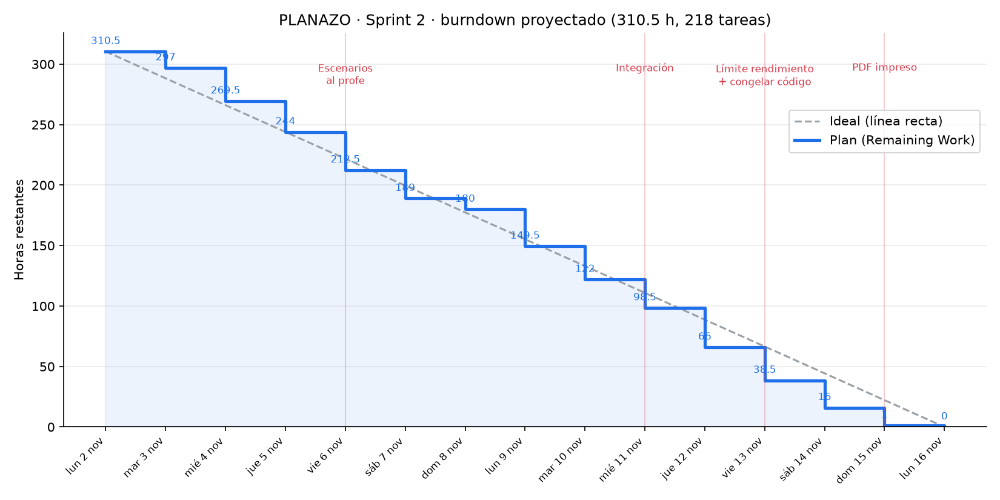

# PLANAZO · Sprint 2: atributos de calidad

**Equipo Spidiverse · Arquitecturas de Software 2026-2 · del 2 al 16 de noviembre de 2026**

> El enunciado dice «noviembre 16 de 2025»: es un error de digitación. El sprint termina el lunes 16 de noviembre de 2026.

## Cómo está armado para que el burndown baje parejo

- **61 historias pequeñas** (1 a 8 puntos) y **218 tareas de 0,5 a 3 horas**. Ninguna tarea dura más de una tarde, así que todos los días se cierran varias.
- Cada tarea trae en su descripción **el día en que debe quedar hecha**. Si cada uno cierra lo de su día y baja el *Remaining Work*, el burndown real queda pegado al plan.
- Las historias de cada persona van en orden: se cierran una tras otra y no quedan todas abiertas hasta el final.
- El Scrum Master (P4) tiene una tarea de 30 min por día: daily y actualizar el burndown. Así el gráfico baja todos los días, también los fines de semana.
- **Regla de oro:** al final del día, cada uno pone su *Remaining Work* real (aunque la tarea no esté terminada) y mueve a *Done* lo que acabó. El burndown de Azure sale de ese número.

## Reparto

En Azure: **P1 = Juan Diego Melo**, **P2 = Diego Andrade**, **P3 = Diego Rozo**, **P4 = Juan Camilo Melo**. Iteración **Sprint 2 - Proyecto** (3 al 16 de noviembre), Epic **Atributos de calidad — Sprint 2 del proyecto**.

| Persona | Foco | Historias | Puntos | Horas | Capacidad sugerida en Azure |
|---|---|---|---|---|---|
| **P1** | Disponibilidad y Rendimiento (tú) | 16 | 52 | 95 h | 8.5 h/día entre semana, 6.8 sáb, 3.4 dom |
| **P2** | Seguridad | 14 | 40 | 76 h | 6.7 h/día entre semana, 5.4 sáb, 2.7 dom |
| **P3** | Observabilidad | 15 | 40 | 70 h | 6.4 h/día entre semana, 5.1 sáb, 2.5 dom |
| **P4** | Mantenibilidad, Documento y Scrum Master | 16 | 39 | 69.5 h | 5.6 h/día entre semana, 4.5 sáb, 2.3 dom |
| | **Total** | **61** | **171** | **310.5 h** | |

**P1 eres tú.** Te quedó lo más difícil y lo que más pesa en la nota: el balanceador, realtime con 2 instancias sin romper el `seq` ni el RESUME, la decisión de cómo escalar el Minijuego, la prueba de caos, la caché Redis y las pruebas de carga sobre WebSocket con k6. Para no pasarte de horas, el circuit breaker quedó con P2 (que ya trabaja en el gateway), el marcador CC-2 con P3 (que ya trabaja en game) y la reconexión del frontend con P4 (que ya trabaja en el frontend). También el diagrama de despliegue, que es el obligatorio.

**P2 (Seguridad)** arranca con el escenario que ya escribieron tus panas para el Minijuego (S1) y le suma fuerza bruta (S2) y detección más auditoría (S3).

Dependencias:

- **P1 → P3:** el timestamp de los eventos alimenta la métrica de latencia en tiempo real. El tablero técnico se valida durante la prueba de caos.
- **P2 → P3:** la alerta de ataque se muestra en el tablero técnico.
- **P1 ↔ P2:** el bloqueo de intentos y el rate limit van en Redis para que funcionen con varias instancias.
- **Todos → P4:** cada uno escribe sus escenarios y ADRs; P4 los consolida. Cada uno corrige los issues de Sonar de su propio código.

## Hitos

| Fecha | Hito |
|---|---|
| mar 3 nov | Sprint Planning: importar el CSV, asignar, fijar la capacidad. Arranca el burndown. |
| vie 6 nov | Los 7 escenarios al profesor. **Los 3 de seguridad y el de rendimiento necesitan aprobación.** |
| mié 11 nov | Integración: balanceador e instancias en producción, Sonar en los 7 repos, métricas llegando. |
| vie 13 nov | **Límite para aprobar el escenario de rendimiento.** Pruebas de carga y de caos corridas. Congelar código. |
| sáb 14 nov | Tableros con datos reales, cobertura y calificación A cerradas, documento en revisión. |
| dom 15 nov | PDF impreso y diagramas por Teams. |
| lun 16 nov | Entrega, Sprint Review con demo y Retrospectiva. Todo en Done. |

## Plan día a día

Lo que cada uno debe dejar **terminado** ese día. La columna del final es el *Remaining Work* total que debería mostrar el burndown esa noche.

| Día | P1 (tú) | P2 | P3 | P4 | Restante |
|---|---|---|---|---|---|
| **mar 3 nov** | HU-93: Inventariar el estado en memoria de gateway, booking, promo, realtime y game (2 h) HU-93: Diseñar la topología: qué va en Vercel, en cada servicio de Railway, Postgres y Redis (2 h) HU-93: Escribir ADR-01: balanceador de carga explícito (Nginx) (1 h) | HU-109: Pulir S1: agregar el caso de autorización (actuar a nombre de otro) y la medida verificable (1 h) HU-109: Redactar S2: fuerza bruta contra negocios (1 h) HU-109: Redactar S3: detección de ataques y trazabilidad (1 h) | HU-123: Redactar el escenario O1 (1 h) HU-123: Spike: Grafana Cloud (Alloy/OTLP) vs. Prometheus en Railway (2 h) | HU-138: Crear la iteración Sprint 2 y los días libres (1 h) HU-138: Importar el CSV, asignar por etiqueta y fijar la capacidad (1 h) HU-152: Daily y actualizar el burndown (mar 3 nov) (0.5 h) | 297 h |
| **mié 4 nov** | HU-93: Escribir ADR-02: estado compartido en Redis/Postgres, servicios sin estado (1 h) HU-93: Boceto del diagrama de despliegue y revisión con el equipo (1 h) HU-94: Redactar el escenario R1 en 6 partes (1 h) HU-95: Redactar el escenario D1 en 6 partes (1 h) HU-95: Definir cómo se va a medir cada respuesta del escenario (1 h) HU-96: nginx.conf con upstream al gateway y Dockerfile del balanceador (2 h) | HU-110: Revisar SecurityConfig y la validación de firma, expiración y emisor (2 h) HU-110: Respuesta 401 uniforme que no revela si el recurso existe (1 h) HU-110: Pruebas MockMvc: sin token, token expirado, token manipulado (2 h) HU-111: Reforzar StompAuthChannelInterceptor para cortar el CONNECT (2 h) | HU-123: Escribir ADR-07 con la herramienta elegida (1 h) HU-124: pino en api-gateway (1 h) HU-124: pino en booking (1 h) HU-124: pino en promo (1 h) HU-124: pino en realtime (1 h) HU-124: Redactar los campos sensibles (tokens, contraseñas) (1 h) | HU-139: Investigar sonarqube-scan-action, PR decoration y Quality Gate (2 h) HU-139: Verificar el plan de SonarCloud para repos privados (1 h) HU-139: Redactar el escenario M1 y el documento de investigación (1 h) HU-140: Crear la organización y los 7 proyectos en SonarCloud (1 h) HU-140: Cargar SONAR_TOKEN como secreto en GitHub (1 h) HU-141: Sonar + lcov en api-gateway (1 h) HU-152: Daily y actualizar el burndown (mié 4 nov) (0.5 h) | 269.5 h |
| **jue 5 nov** | HU-96: Desplegar el balanceador como servicio en Railway con dominio público (2 h) HU-96: Levantar 2 instancias del gateway (réplicas o gateway-1 / gateway-2) (2 h) HU-96: Header x-instance-id en las respuestas del gateway (1 h) HU-96: Cambiar NEXT_PUBLIC_API_URL en Vercel al balanceador y verificar la app (1 h) HU-97: Configurar el ThrottlerStorage del gateway con Redis (2 h) | HU-111: Pruebas de integración del CONNECT sin token y con token inválido (2 h) HU-111: Medir que el rechazo tome < 200 ms (1 h) HU-112: Validar jugadorId == jwt.sub en unirse a sala (1 h) HU-112: Histórico de partidas solo para su dueño (2 h) | HU-125: Logback con encoder JSON en game (2 h) HU-126: Middleware que genera x-correlation-id en el gateway (1 h) HU-126: Propagarlo a booking, promo y game por HTTP (2 h) HU-126: Propagarlo en los eventos del bus y en realtime (2 h) | HU-141: Sonar + lcov en booking (1 h) HU-141: Sonar + lcov en promo (1 h) HU-141: Sonar + lcov en realtime (1 h) HU-141: Sonar + lcov en service-template (1 h) HU-152: Daily y actualizar el burndown (jue 5 nov) (0.5 h) | 244 h |
| **vie 6 nov** | HU-94: Presentar el escenario al profesor junto con los de seguridad (1 h) HU-97: Pruebas del rate limit compartido con 2 instancias locales (2 h) HU-97: Quitar el estado en memoria que quede en el gateway (1 h) HU-98: Endpoint /health/ready y x-instance-id en booking y promo (1 h) HU-98: Configurar 2 instancias de booking y promo en Railway (1 h) HU-98: Repetir la prueba de CC-3 (25 reservas simultáneas) con 2 instancias (2 h) HU-98: Repetir la prueba de CC-1 (60 personas contra stock 5) con 2 instancias (2 h) | HU-109: Enviar los 3 escenarios y las tácticas al profesor (1 h) HU-112: Pruebas de 403 y verificación de 0 llamadas al dominio (mocks) (2 h) HU-113: Script de peticiones inválidas contra REST y STOMP (2 h) HU-113: Correrlo en producción y guardar el reporte (1 h) HU-114: Columna password_hash y migración en booking (2 h) | HU-127: Enviar los logs a la herramienta elegida (2 h) HU-127: Probar la búsqueda de una reserva por correlation-id (1 h) HU-128: prom-client con histograma de latencia HTTP en el gateway (2 h) HU-128: prom-client en booking y promo (1 h) | HU-142: Sonar con Maven y JaCoCo en game (2 h) HU-142: Sonar con lcov en planazo-frontend (1 h) HU-143: Quality Gate como check obligatorio en los repos (1 h) HU-143: Badges de Sonar en los README (1 h) HU-144: Corregir bugs reportados en los servicios NestJS (2 h) HU-152: Daily y actualizar el burndown (vie 6 nov) (0.5 h) | 212.5 h |
| **sáb 7 nov** | HU-99: Script de reparto de 1000 peticiones por instancia (2 h) HU-99: Correrlo en producción y guardar la evidencia (1 h) HU-100: Analizar cómo realtime consume el bus y genera el seq (2 h) HU-100: Fan-out: cada instancia escucha el bus Redis y entrega a sus clientes (3 h) | HU-114: Login de negocio con bcrypt (2 h) HU-114: Formulario de contraseña en el frontend (crear y entrar) (2 h) HU-114: Migrar las cuentas existentes, incluido Telaraña Bar (1 h) | HU-128: Gauge de conexiones WebSocket activas en realtime (1 h) HU-128: Histograma de latencia de eventos (con el timestamp de P1) (1 h) HU-128: Proteger /metrics (1 h) HU-129: Micrometer + Actuator Prometheus en game (1 h) HU-129: Métricas de salas activas, jugadores y duración del tick (2 h) | HU-144: Corregir bugs reportados en game y frontend (2 h) HU-144: Corregir vulnerabilidades (2 h) HU-152: Daily y actualizar el burndown (sáb 7 nov) (0.5 h) | 189 h |
| **dom 8 nov** | HU-100: Asegurar el seq global con una secuencia de PostgreSQL (2 h) | HU-115: Contador de intentos fallidos en Redis (2 h) HU-115: Bloqueo de 15 minutos y error genérico (1 h) | HU-130: Revisar que todas las sumas usen ZINCRBY y la lectura salga de Redis (1 h) | HU-144: Revisar security hotspots con P2 (1 h) HU-145: Corregir code smells críticos en los servicios NestJS (2 h) | 180 h |
| **lun 9 nov** | HU-100: docker-compose local con 2 instancias de realtime y Nginx (2 h) HU-100: Configurar el upgrade de WebSocket y timeouts en Nginx (2 h) HU-100: Prueba: cliente en la instancia A recibe un evento publicado vía la instancia B (2 h) HU-100: Prueba: RESUME tras reconectar en la otra instancia, sin duplicados (2 h) HU-100: Desplegar realtime con 2 instancias en Railway (1 h) HU-101: Analizar el actor por sala y el estado del juego (1 h) | HU-109: Ajustar con los comentarios del profesor (1 h) HU-115: Prueba automatizada de fuerza bruta (2 h) HU-116: Tabla audit_log append-only (sin UPDATE/DELETE para la app) (2 h) HU-116: Interceptor de auditoría en el gateway (2 h) HU-116: Auditar las operaciones sensibles de booking y promo (2 h) | HU-130: Prueba de varias salas terminando al mismo tiempo (2 h) HU-130: Medir el tiempo de lectura del top del marcador (1 h) HU-131: Desplegar el recolector (Alloy o Prometheus) en Railway (2 h) HU-131: Configurar el descubrimiento de todas las instancias (2 h) | HU-145: Corregir code smells críticos en game y frontend (2 h) HU-145: Bajar la duplicación a ≤ 3 % (2 h) HU-152: Daily y actualizar el burndown (lun 9 nov) (0.5 h) | 149.5 h |
| **mar 10 nov** | HU-94: Ajustar el escenario con los comentarios del profesor (1 h) HU-101: Escribir ADR-03: afinidad por sala vs. instancia única (1 h) HU-101: Hash por salaId en Nginx (o fijar instancia única) (3 h) HU-101: Partida de prueba de dos bots con la configuración elegida (1 h) HU-102: max_fails / fail_timeout y proxy_next_upstream en Nginx (1 h) HU-102: restartPolicy ON_FAILURE en railway.json de los 5 servicios (1 h) HU-102: Medir cuánto tarda en salir de rotación una instancia caída (1 h) | HU-117: Detector de ráfagas 401/429 por IP (2 h) HU-117: Bloqueo de IP por 10 minutos en Redis (1 h) HU-117: Log de alerta y métrica para el tablero técnico (con P3) (1 h) HU-117: Script de ataque simulado y evidencia (1 h) | HU-131: Verificar que llegan métricas de cada instancia (1 h) HU-132: Definir los KPIs del tablero a partir del business case y PLANAZO-KPIs (1 h) HU-132: Contadores de sesiones y usuarios activos en el gateway (1 h) HU-132: Contadores de reservas por zona en booking (1 h) HU-132: Contadores de cupones reclamados en promo (1 h) HU-132: Contadores de partidas en game y consultas al agente (1 h) | HU-146: Configurar Vitest + Testing Library con lcov (2 h) HU-147: Reconexión con backoff en el cliente WebSocket (2 h) HU-147: RESUME con el último seq al reconectar (1 h) HU-147: Aviso de «reconectando» en la UI (1 h) HU-147: Prueba manual matando realtime en local (1 h) HU-152: Daily y actualizar el burndown (mar 10 nov) (0.5 h) | 122 h |
| **mié 11 nov** | HU-103: Script k6 de carga mixta con 100 usuarios (2 h) HU-103: Documentar el procedimiento para apagar una instancia en Railway (1 h) HU-103: Correr la prueba de caos y medir (2 h) HU-103: Grabar el video de evidencia (1 h) | HU-118: Circuit breaker con opossum en el proxy hacia booking (2 h) HU-118: Circuit breaker hacia promo (1 h) HU-118: Reintentos con backoff solo para GET (1 h) HU-118: Respuesta 503 SERVICIO_NO_DISPONIBLE con el formato { code, message } (1 h) HU-118: Pruebas unitarias del circuit breaker (2 h) | HU-133: Paneles de usuarios, sesiones y tiempo de interacción (2 h) HU-133: Paneles de reservas, cupones, partidas y agente (2 h) HU-133: Filtros por zona y tiempo (1 h) HU-133: Sesión de uso con el equipo y captura para la entrega (1 h) | HU-148: Pruebas de login (1 h) HU-148: Pruebas de ficha de lugar y reserva (2 h) HU-148: Pruebas de reclamo de promo (1 h) HU-152: Daily y actualizar el burndown (mié 11 nov) (0.5 h) | 98.5 h |
| **jue 12 nov** | HU-104: Cache-aside del catálogo de lugares en Redis (3 h) HU-104: Invalidar la caché al recibir PLACE.UPDATE (2 h) HU-104: TTL y contador de aciertos/fallos (1 h) HU-104: Pruebas de la caché y de la invalidación (2 h) HU-105: Timestamp de emisión en los eventos del bus y de realtime (2 h) | HU-119: Pruebas del módulo de auth (2 h) HU-119: Pruebas del proxy y guards (2 h) HU-119: Pruebas del módulo del agente (2 h) HU-119: Cerrar huecos hasta 80 % (1 h) | HU-134: Paneles de latencia HTTP y de eventos en tiempo real (2 h) HU-134: Paneles de concurrencia, CPU y memoria por instancia (2 h) HU-134: Panel de errores y estado de cada componente (1 h) HU-135: Configurar las 4 alertas (2 h) HU-135: Validarlas durante la prueba de carga y de caos con P1 (1 h) | HU-148: Pruebas del cliente WebSocket (reconexión) (2 h) HU-148: Pruebas del panel de negocio (2 h) HU-148: Cerrar huecos hasta 40 % (1 h) HU-149: Estructura del documento v2 (1 h) HU-149: Requerimientos funcionales relevantes (1 h) HU-152: Daily y actualizar el burndown (jue 12 nov) (0.5 h) | 66 h |
| **vie 13 nov** | HU-105: Script k6: 500 conexiones, AUTH y SUBSCRIBE a zone:zona-t (2 h) HU-105: Medir la latencia por evento en el script k6 (2 h) HU-105: Correr la prueba contra producción y guardar resultados (1 h) HU-106: Script k6 HTTP de 200 reservas concurrentes (2 h) HU-106: Correr con 1 instancia y con 2 instancias (2 h) | HU-120: Pruebas de reservas y lock optimista (2 h) HU-120: Pruebas de lugares y capacidad (2 h) HU-120: Pruebas de cuentas (1 h) HU-120: Cerrar huecos hasta 80 % (1 h) | HU-136: Pruebas de AUTH y SUBSCRIBE (2 h) HU-136: Pruebas de RESUME y REPLAY (2 h) HU-136: Pruebas del consumo del bus (1 h) HU-136: Cerrar huecos hasta 80 % (1 h) | HU-149: Restricciones tecnológicas y supuestos (1 h) HU-150: Diagrama de contexto (1 h) HU-150: Diagrama de componentes (2 h) HU-150: Diagrama de clases (2 h) HU-152: Daily y actualizar el burndown (vie 13 nov) (0.5 h) | 38.5 h |
| **sáb 14 nov** | HU-107: Analizar resultados e identificar el cuello de botella (2 h) HU-107: Optimizar el cuello de botella y repetir la medición (2 h) HU-107: Escribir el reporte de rendimiento con gráficas (2 h) | HU-121: Pruebas del reclamo de cupones (Lua) (2 h) HU-121: Pruebas de creación y vigencia de promos (2 h) HU-121: Pruebas del listener de GAME.PARTIDA_FINALIZADA (1 h) HU-121: Cerrar huecos hasta 80 % (1 h) HU-122: Escribir ADR-05: JWT stateless (sin sesión de servidor, ayuda a escalar) (1 h) | HU-137: Configurar JaCoCo y el reporte para Sonar (1 h) HU-137: Pruebas del tick y del movimiento (2 h) HU-137: Pruebas de colisiones y fin de partida (2 h) | HU-150: Diagrama entidad-relación (2 h) HU-150: Diagrama de actividades (reserva con promo) (1 h) HU-151: Consolidar los 7 escenarios (1 h) HU-152: Daily y actualizar el burndown (sáb 14 nov) (0.5 h) | 16 h |
| **dom 15 nov** | HU-107: Diagrama de secuencia del flujo en tiempo real (2 h) HU-108: Diagrama UML de despliegue final (2 h) HU-108: Escribir ADR-04: tácticas de tolerancia a fallos (1 h) | HU-122: Escribir ADR-06: auditoría y detección de ataques (1 h) HU-122: Sección de tácticas de seguridad para el documento (2 h) | HU-137: Pruebas del marcador y los resultados (2 h) HU-137: Cerrar huecos hasta 80 % (1 h) | HU-151: Consolidar los ADR de todos (1 h) HU-151: Revisión cruzada con el equipo (1 h) HU-151: Exportar PDF, imprimir y enviar diagramas por Teams (1 h) HU-153: Preparar la demo de la Sprint Review (1 h) | 1 h |
| **lun 16 nov** | — | — | — | HU-153: Retrospectiva y cierre del sprint en Azure (1 h) | 0 h |

## Escenarios de calidad

La versión entregada al profesor está en [`escenarios-de-calidad.pdf`](escenarios-de-calidad.pdf) (y en Word, [`escenarios-de-calidad.docx`](escenarios-de-calidad.docx)). Son 7: ESC-01 a ESC-03 de seguridad, ESC-04 de disponibilidad, ESC-05 de mantenibilidad, ESC-06 de rendimiento y ESC-07 de observabilidad. Las historias de abajo todavía citan los códigos del primer borrador: D1 = ESC-04, S1 = ESC-02, S2 = ESC-01, S3 = ESC-03, M1 = ESC-05, R1 = ESC-06, O1 = ESC-07.

## Sprint Backlog

### Feature: Feature 10.1 — Disponibilidad: escalabilidad horizontal y tolerancia a fallos

#### HU-93 · Topología del despliegue distribuido

**P1** · 2 pts · terminar a más tardar el **mié 4 nov** · escenarios D1

*Como equipo, queremos decidir cómo se reparten físicamente los componentes, para que la arquitectura no sea monolítica.*

Criterios de aceptación:

- [ ] Hay un inventario del estado en memoria de cada servicio.
- [ ] ADR-01 (balanceador) y ADR-02 (estado compartido) escritos.
- [ ] Boceto del diagrama de despliegue revisado por el equipo.

| Tarea | Horas | Actividad | Día |
|---|---|---|---|
| Inventariar el estado en memoria de gateway, booking, promo, realtime y game | 2 | Requirements | mar 3 nov |
| Diseñar la topología: qué va en Vercel, en cada servicio de Railway, Postgres y Redis | 2 | Design | mar 3 nov |
| Escribir ADR-01: balanceador de carga explícito (Nginx) | 1 | Documentation | mar 3 nov |
| Escribir ADR-02: estado compartido en Redis/Postgres, servicios sin estado | 1 | Documentation | mié 4 nov |
| Boceto del diagrama de despliegue y revisión con el equipo | 1 | Documentation | mié 4 nov |

#### HU-95 · Escenario de disponibilidad documentado

**P1** · 1 pts · terminar a más tardar el **mié 4 nov** · escenarios D1

*Como equipo, queremos el escenario de disponibilidad escrito, para saber exactamente qué demostrar.*

Criterios de aceptación:

- [ ] Escenario D1 en 6 partes con medidas concretas.
- [ ] Revisado por el equipo.

| Tarea | Horas | Actividad | Día |
|---|---|---|---|
| Redactar el escenario D1 en 6 partes | 1 | Requirements | mié 4 nov |
| Definir cómo se va a medir cada respuesta del escenario | 1 | Requirements | mié 4 nov |

#### HU-96 · Balanceador Nginx delante del api-gateway

**P1** · 5 pts · terminar a más tardar el **jue 5 nov** · escenarios D1

*Como cliente de Planazo, quiero que mis peticiones se repartan entre varios servidores, para que la app no se caiga cuando entra mucha gente.*

Criterios de aceptación:

- [ ] Nginx corre como servicio propio en Railway.
- [ ] Hay al menos 2 instancias del gateway detrás del balanceador.
- [ ] El frontend apunta al balanceador.
- [ ] Cada respuesta trae x-instance-id.

| Tarea | Horas | Actividad | Día |
|---|---|---|---|
| nginx.conf con upstream al gateway y Dockerfile del balanceador | 2 | Development | mié 4 nov |
| Desplegar el balanceador como servicio en Railway con dominio público | 2 | Deployment | jue 5 nov |
| Levantar 2 instancias del gateway (réplicas o gateway-1 / gateway-2) | 2 | Deployment | jue 5 nov |
| Header x-instance-id en las respuestas del gateway | 1 | Development | jue 5 nov |
| Cambiar NEXT_PUBLIC_API_URL en Vercel al balanceador y verificar la app | 1 | Deployment | jue 5 nov |

#### HU-97 · Gateway sin estado: rate limit compartido en Redis

**P1** · 3 pts · terminar a más tardar el **vie 6 nov** · escenarios D1

*Como equipo, queremos que el rate limit sea el mismo en todas las instancias, para que escalar no abra un hueco de seguridad.*

Criterios de aceptación:

- [ ] El rate limit se guarda en Redis.
- [ ] Con 2 instancias el límite por IP se respeta en total, no por instancia.
- [ ] No queda estado en memoria en el gateway.

| Tarea | Horas | Actividad | Día |
|---|---|---|---|
| Configurar el ThrottlerStorage del gateway con Redis | 2 | Development | jue 5 nov |
| Pruebas del rate limit compartido con 2 instancias locales | 2 | Testing | vie 6 nov |
| Quitar el estado en memoria que quede en el gateway | 1 | Development | vie 6 nov |

#### HU-98 · booking y promo con varias instancias

**P1** · 3 pts · terminar a más tardar el **vie 6 nov** · escenarios D1

*Como cliente, quiero que las reservas y los cupones sigan siendo correctos aunque haya varias copias del servicio, para no perder mi cupo.*

Criterios de aceptación:

- [ ] booking y promo corren con 2 instancias.
- [ ] CC-3 sigue sin sobreventa con 2 instancias.
- [ ] CC-1 sigue entregando exactamente el stock con 2 instancias.
- [ ] /health/ready en ambos.

| Tarea | Horas | Actividad | Día |
|---|---|---|---|
| Endpoint /health/ready y x-instance-id en booking y promo | 1 | Development | vie 6 nov |
| Configurar 2 instancias de booking y promo en Railway | 1 | Deployment | vie 6 nov |
| Repetir la prueba de CC-3 (25 reservas simultáneas) con 2 instancias | 2 | Testing | vie 6 nov |
| Repetir la prueba de CC-1 (60 personas contra stock 5) con 2 instancias | 2 | Testing | vie 6 nov |

#### HU-99 · Script que demuestra el reparto de carga

**P1** · 2 pts · terminar a más tardar el **sáb 7 nov** · escenarios D1

*Como profesor, quiero ver con datos que la carga se reparte entre instancias, para evaluar la escalabilidad.*

Criterios de aceptación:

- [ ] Script que manda 1000 peticiones y cuenta respuestas por x-instance-id.
- [ ] Evidencia guardada para la entrega.

| Tarea | Horas | Actividad | Día |
|---|---|---|---|
| Script de reparto de 1000 peticiones por instancia | 2 | Testing | sáb 7 nov |
| Correrlo en producción y guardar la evidencia | 1 | Testing | sáb 7 nov |

#### HU-100 · realtime con 2 instancias sin perder el orden de los eventos

**P1** · 8 pts · terminar a más tardar el **lun 9 nov** · escenarios D1, R1

*Como cliente que mira el mapa, quiero recibir los eventos en vivo sin importar a qué servidor estoy conectado, para ver siempre los cupos reales.*

Criterios de aceptación:

- [ ] realtime corre con 2 instancias detrás del balanceador (upgrade de WebSocket).
- [ ] Un evento llega a clientes conectados a cualquier instancia.
- [ ] El seq sigue siendo global y único.
- [ ] RESUME funciona al reconectar en otra instancia.

| Tarea | Horas | Actividad | Día |
|---|---|---|---|
| Analizar cómo realtime consume el bus y genera el seq | 2 | Design | sáb 7 nov |
| Fan-out: cada instancia escucha el bus Redis y entrega a sus clientes | 3 | Development | sáb 7 nov |
| Asegurar el seq global con una secuencia de PostgreSQL | 2 | Development | dom 8 nov |
| docker-compose local con 2 instancias de realtime y Nginx | 2 | Development | lun 9 nov |
| Configurar el upgrade de WebSocket y timeouts en Nginx | 2 | Deployment | lun 9 nov |
| Prueba: cliente en la instancia A recibe un evento publicado vía la instancia B | 2 | Testing | lun 9 nov |
| Prueba: RESUME tras reconectar en la otra instancia, sin duplicados | 2 | Testing | lun 9 nov |
| Desplegar realtime con 2 instancias en Railway | 1 | Deployment | lun 9 nov |

#### HU-101 · Minijuego escalable por sala

**P1** · 3 pts · terminar a más tardar el **mar 10 nov** · escenarios D1

*Como jugador, quiero que mi sala funcione igual aunque haya varios servidores de juego, para no ver la partida desincronizada.*

Criterios de aceptación:

- [ ] ADR-03 decide afinidad por sala o instancia única justificada.
- [ ] Si se escala, una sala vive en una sola instancia (hash por salaId).
- [ ] Partida de prueba completa con la configuración elegida.

| Tarea | Horas | Actividad | Día |
|---|---|---|---|
| Analizar el actor por sala y el estado del juego | 1 | Design | lun 9 nov |
| Escribir ADR-03: afinidad por sala vs. instancia única | 1 | Documentation | mar 10 nov |
| Hash por salaId en Nginx (o fijar instancia única) | 3 | Development | mar 10 nov |
| Partida de prueba de dos bots con la configuración elegida | 1 | Testing | mar 10 nov |

#### HU-102 · El balanceador saca de rotación las instancias caídas

**P1** · 3 pts · terminar a más tardar el **mar 10 nov** · escenarios D1

*Como cliente, quiero que si un servidor falla mis peticiones vayan a otro, para no ver errores.*

Criterios de aceptación:

- [ ] max_fails y fail_timeout configurados.
- [ ] Política ON_FAILURE en railway.json de todos los servicios.
- [ ] Una instancia caída sale de rotación en ≤ 10 s.

| Tarea | Horas | Actividad | Día |
|---|---|---|---|
| max_fails / fail_timeout y proxy_next_upstream en Nginx | 1 | Deployment | mar 10 nov |
| restartPolicy ON_FAILURE en railway.json de los 5 servicios | 1 | Deployment | mar 10 nov |
| Medir cuánto tarda en salir de rotación una instancia caída | 1 | Testing | mar 10 nov |

#### HU-103 · Prueba de caos con evidencia

**P1** · 3 pts · terminar a más tardar el **mié 11 nov** · escenarios D1

*Como profesor, quiero ver el sistema aguantar la caída de una instancia en plena carga, para validar el escenario de disponibilidad.*

Criterios de aceptación:

- [ ] Script k6 con 100 usuarios.
- [ ] Procedimiento documentado para apagar una instancia.
- [ ] Resultado con error < 1 % y video de evidencia.

| Tarea | Horas | Actividad | Día |
|---|---|---|---|
| Script k6 de carga mixta con 100 usuarios | 2 | Testing | mié 11 nov |
| Documentar el procedimiento para apagar una instancia en Railway | 1 | Documentation | mié 11 nov |
| Correr la prueba de caos y medir | 2 | Testing | mié 11 nov |
| Grabar el video de evidencia | 1 | Testing | mié 11 nov |

#### HU-118 · Circuit breaker y reintentos en el gateway

**P2** · 5 pts · terminar a más tardar el **mié 11 nov** · escenarios D1

*Como cliente, quiero un mensaje claro si un servicio está caído en vez de que la app se quede cargando, para saber qué pasa.*

Criterios de aceptación:

- [ ] Circuit breaker (opossum) hacia booking y promo.
- [ ] Reintento solo en GET idempotentes.
- [ ] Respuesta 503 SERVICIO_NO_DISPONIBLE.
- [ ] Pruebas unitarias del comportamiento.

| Tarea | Horas | Actividad | Día |
|---|---|---|---|
| Circuit breaker con opossum en el proxy hacia booking | 2 | Development | mié 11 nov |
| Circuit breaker hacia promo | 1 | Development | mié 11 nov |
| Reintentos con backoff solo para GET | 1 | Development | mié 11 nov |
| Respuesta 503 SERVICIO_NO_DISPONIBLE con el formato { code, message } | 1 | Development | mié 11 nov |
| Pruebas unitarias del circuit breaker | 2 | Testing | mié 11 nov |

#### HU-147 · Reconexión automática del frontend al tiempo real

**P4** · 3 pts · terminar a más tardar el **mar 10 nov** · escenarios D1

*Como cliente, quiero que la app se reconecte sola si se cae la conexión en vivo, para no tener que recargar.*

Criterios de aceptación:

- [ ] Reconexión con backoff exponencial.
- [ ] RESUME automático con el último seq.
- [ ] Aviso discreto en la UI mientras reconecta.

| Tarea | Horas | Actividad | Día |
|---|---|---|---|
| Reconexión con backoff en el cliente WebSocket | 2 | Development | mar 10 nov |
| RESUME con el último seq al reconectar | 1 | Development | mar 10 nov |
| Aviso de «reconectando» en la UI | 1 | Development | mar 10 nov |
| Prueba manual matando realtime en local | 1 | Testing | mar 10 nov |

### Feature: Feature 10.2 — Rendimiento / latencia en tiempo real

#### HU-94 · Escenario de rendimiento aprobado por el profesor

**P1** · 1 pts · terminar a más tardar el **mar 10 nov** · escenarios R1

*Como equipo, queremos el escenario de rendimiento aprobado a tiempo, para implementarlo antes del 13 de noviembre.*

Criterios de aceptación:

- [ ] Escenario R1 en formato de 6 partes.
- [ ] Presentado al profesor el 6 de noviembre.
- [ ] Aprobado (o ajustado) antes del 13 de noviembre.

| Tarea | Horas | Actividad | Día |
|---|---|---|---|
| Redactar el escenario R1 en 6 partes | 1 | Requirements | mié 4 nov |
| Presentar el escenario al profesor junto con los de seguridad | 1 | Requirements | vie 6 nov |
| Ajustar el escenario con los comentarios del profesor | 1 | Requirements | mar 10 nov |

#### HU-104 · Caché Redis del catálogo de lugares

**P1** · 5 pts · terminar a más tardar el **jue 12 nov** · escenarios R1

*Como cliente, quiero que el mapa cargue rápido aunque haya mucha gente, para encontrar plan sin esperar.*

Criterios de aceptación:

- [ ] Cache-aside del catálogo en Redis con TTL.
- [ ] Invalidación al recibir PLACE.UPDATE.
- [ ] Métrica de aciertos/fallos de caché.
- [ ] Pruebas de la invalidación.

| Tarea | Horas | Actividad | Día |
|---|---|---|---|
| Cache-aside del catálogo de lugares en Redis | 3 | Development | jue 12 nov |
| Invalidar la caché al recibir PLACE.UPDATE | 2 | Development | jue 12 nov |
| TTL y contador de aciertos/fallos | 1 | Development | jue 12 nov |
| Pruebas de la caché y de la invalidación | 2 | Testing | jue 12 nov |

#### HU-105 · Latencia de eventos medida con k6 sobre WebSocket

**P1** · 5 pts · terminar a más tardar el **vie 13 nov** · escenarios R1

*Como equipo, queremos medir cuánto tarda un evento en llegar a 500 personas, para demostrar el tiempo real.*

Criterios de aceptación:

- [ ] Los eventos llevan el timestamp de emisión.
- [ ] Script k6 de 500 conexiones WebSocket que mide publicación→entrega.
- [ ] Resultado con p50/p95/p99.

| Tarea | Horas | Actividad | Día |
|---|---|---|---|
| Timestamp de emisión en los eventos del bus y de realtime | 2 | Development | jue 12 nov |
| Script k6: 500 conexiones, AUTH y SUBSCRIBE a zone:zona-t | 2 | Testing | vie 13 nov |
| Medir la latencia por evento en el script k6 | 2 | Testing | vie 13 nov |
| Correr la prueba contra producción y guardar resultados | 1 | Testing | vie 13 nov |

#### HU-106 · Stress test de reservas concurrentes

**P1** · 3 pts · terminar a más tardar el **vie 13 nov** · escenarios R1

*Como dueño de negocio, quiero saber que mis cupos no se sobrevenden aunque reserven cientos a la vez, para confiar en Planazo.*

Criterios de aceptación:

- [ ] Script k6 HTTP de 200 reservas concurrentes.
- [ ] Comparación 1 instancia vs. 2 instancias.
- [ ] 0 sobreventas.

| Tarea | Horas | Actividad | Día |
|---|---|---|---|
| Script k6 HTTP de 200 reservas concurrentes | 2 | Testing | vie 13 nov |
| Correr con 1 instancia y con 2 instancias | 2 | Testing | vie 13 nov |

#### HU-107 · Reporte de rendimiento y optimización

**P1** · 3 pts · terminar a más tardar el **dom 15 nov** · escenarios R1

*Como profesor, quiero un reporte con los números de la prueba, para comprobar el escenario de rendimiento.*

Criterios de aceptación:

- [ ] Se identifica y corrige al menos un cuello de botella.
- [ ] Reporte con gráficas y p50/p95/p99.
- [ ] Diagrama de secuencia del flujo en tiempo real.

| Tarea | Horas | Actividad | Día |
|---|---|---|---|
| Analizar resultados e identificar el cuello de botella | 2 | Testing | sáb 14 nov |
| Optimizar el cuello de botella y repetir la medición | 2 | Development | sáb 14 nov |
| Escribir el reporte de rendimiento con gráficas | 2 | Documentation | sáb 14 nov |
| Diagrama de secuencia del flujo en tiempo real | 2 | Documentation | dom 15 nov |

#### HU-130 · Marcador del Minijuego en Redis bajo carga (CC-2)

**P3** · 2 pts · terminar a más tardar el **lun 9 nov** · escenarios R1

*Como jugador, quiero ver el marcador global al instante aunque terminen muchas salas a la vez, para saber si gané.*

Criterios de aceptación:

- [ ] El marcador usa ZINCRBY (suma atómica) en el sorted set.
- [ ] Prueba con varias salas terminando a la vez sin perder puntos.
- [ ] Medición del tiempo de lectura del top.

| Tarea | Horas | Actividad | Día |
|---|---|---|---|
| Revisar que todas las sumas usen ZINCRBY y la lectura salga de Redis | 1 | Development | dom 8 nov |
| Prueba de varias salas terminando al mismo tiempo | 2 | Testing | lun 9 nov |
| Medir el tiempo de lectura del top del marcador | 1 | Testing | lun 9 nov |

### Feature: Feature 10.3 — Seguridad

#### HU-109 · Escenarios de seguridad aprobados por el profesor

**P2** · 2 pts · terminar a más tardar el **lun 9 nov** · escenarios S1, S2, S3

*Como equipo, queremos los 3 escenarios de seguridad aprobados, para implementarlos sin rehacer trabajo.*

Criterios de aceptación:

- [ ] S1 (autenticación y autorización del Minijuego) pulido.
- [ ] S2 y S3 redactados.
- [ ] Enviados al profesor el 6 de noviembre y aprobados.

| Tarea | Horas | Actividad | Día |
|---|---|---|---|
| Pulir S1: agregar el caso de autorización (actuar a nombre de otro) y la medida verificable | 1 | Requirements | mar 3 nov |
| Redactar S2: fuerza bruta contra negocios | 1 | Requirements | mar 3 nov |
| Redactar S3: detección de ataques y trazabilidad | 1 | Requirements | mar 3 nov |
| Enviar los 3 escenarios y las tácticas al profesor | 1 | Requirements | vie 6 nov |
| Ajustar con los comentarios del profesor | 1 | Requirements | lun 9 nov |

#### HU-110 · REST del Minijuego rechaza peticiones sin JWT válido

**P2** · 3 pts · terminar a más tardar el **mié 4 nov** · escenarios S1

*Como jugador, quiero que nadie pueda unirse a una sala a mi nombre, para que mis partidas sean mías.*

Criterios de aceptación:

- [ ] SecurityConfig valida firma, expiración y emisor del JWT (Resource Server).
- [ ] Sin token, expirado o manipulado → 401 sin revelar si la sala existe.
- [ ] Pruebas MockMvc de los tres casos.

| Tarea | Horas | Actividad | Día |
|---|---|---|---|
| Revisar SecurityConfig y la validación de firma, expiración y emisor | 2 | Development | mié 4 nov |
| Respuesta 401 uniforme que no revela si el recurso existe | 1 | Development | mié 4 nov |
| Pruebas MockMvc: sin token, token expirado, token manipulado | 2 | Testing | mié 4 nov |

#### HU-111 · STOMP del Minijuego rechaza el CONNECT sin JWT válido

**P2** · 3 pts · terminar a más tardar el **jue 5 nov** · escenarios S1

*Como jugador, quiero que solo jugadores autenticados entren a la partida en vivo, para que nadie se cuele.*

Criterios de aceptación:

- [ ] StompAuthChannelInterceptor cierra el CONNECT sin JWT válido.
- [ ] Pruebas de integración WebSocket.
- [ ] Rechazo en < 200 ms.

| Tarea | Horas | Actividad | Día |
|---|---|---|---|
| Reforzar StompAuthChannelInterceptor para cortar el CONNECT | 2 | Development | mié 4 nov |
| Pruebas de integración del CONNECT sin token y con token inválido | 2 | Testing | jue 5 nov |
| Medir que el rechazo tome < 200 ms | 1 | Testing | jue 5 nov |

#### HU-112 · Un jugador solo actúa y consulta a su propio nombre

**P2** · 3 pts · terminar a más tardar el **vie 6 nov** · escenarios S1

*Como jugador, quiero que nadie vea mi histórico ni juegue por mí, para proteger mi información.*

Criterios de aceptación:

- [ ] jugadorId debe ser igual a jwt.sub al unirse a una sala.
- [ ] El histórico solo se devuelve a su dueño.
- [ ] 403 en ambos casos, sin tocar el dominio.

| Tarea | Horas | Actividad | Día |
|---|---|---|---|
| Validar jugadorId == jwt.sub en unirse a sala | 1 | Development | jue 5 nov |
| Histórico de partidas solo para su dueño | 2 | Development | jue 5 nov |
| Pruebas de 403 y verificación de 0 llamadas al dominio (mocks) | 2 | Testing | vie 6 nov |

#### HU-113 · Prueba automatizada del escenario S1

**P2** · 2 pts · terminar a más tardar el **vie 6 nov** · escenarios S1

*Como profesor, quiero ver con datos que el 100 % de las peticiones inválidas se rechaza, para aprobar el escenario.*

Criterios de aceptación:

- [ ] Script que manda peticiones sin token, expiradas, manipuladas y a nombre de otro.
- [ ] Reporte con % rechazado y tiempos.
- [ ] Evidencia para la entrega.

| Tarea | Horas | Actividad | Día |
|---|---|---|---|
| Script de peticiones inválidas contra REST y STOMP | 2 | Testing | vie 6 nov |
| Correrlo en producción y guardar el reporte | 1 | Testing | vie 6 nov |

#### HU-114 · Contraseña para las cuentas de negocio

**P2** · 3 pts · terminar a más tardar el **sáb 7 nov** · escenarios S2

*Como dueño de negocio, quiero entrar con contraseña, para que nadie me lance promociones falsas con solo escribir mi nombre.*

Criterios de aceptación:

- [ ] password_hash con bcrypt (cost ≥ 10).
- [ ] Política mínima de 8 caracteres.
- [ ] Formulario en el frontend.
- [ ] Cuentas existentes migradas.

| Tarea | Horas | Actividad | Día |
|---|---|---|---|
| Columna password_hash y migración en booking | 2 | Development | vie 6 nov |
| Login de negocio con bcrypt | 2 | Development | sáb 7 nov |
| Formulario de contraseña en el frontend (crear y entrar) | 2 | Development | sáb 7 nov |
| Migrar las cuentas existentes, incluido Telaraña Bar | 1 | Deployment | sáb 7 nov |

#### HU-115 · Bloqueo por intentos fallidos

**P2** · 3 pts · terminar a más tardar el **lun 9 nov** · escenarios S2

*Como dueño de negocio, quiero que mi cuenta se bloquee ante intentos repetidos, para que no adivinen mi contraseña.*

Criterios de aceptación:

- [ ] Contador en Redis (compartido por instancias).
- [ ] Bloqueo de 15 min al 5.º intento.
- [ ] Error genérico.
- [ ] Prueba automatizada de fuerza bruta.

| Tarea | Horas | Actividad | Día |
|---|---|---|---|
| Contador de intentos fallidos en Redis | 2 | Development | dom 8 nov |
| Bloqueo de 15 minutos y error genérico | 1 | Development | dom 8 nov |
| Prueba automatizada de fuerza bruta | 2 | Testing | lun 9 nov |

#### HU-116 · Bitácora de auditoría

**P2** · 3 pts · terminar a más tardar el **lun 9 nov** · escenarios S3

*Como administrador, quiero saber quién hizo qué y cuándo, para tener evidencia ante cualquier problema.*

Criterios de aceptación:

- [ ] Tabla audit_log append-only.
- [ ] Se auditan login, crear/editar promo, cambiar capacidad, crear lugar, reclamar cupón y cancelar reserva.
- [ ] Cada registro tiene correlation-id e IP.

| Tarea | Horas | Actividad | Día |
|---|---|---|---|
| Tabla audit_log append-only (sin UPDATE/DELETE para la app) | 2 | Development | lun 9 nov |
| Interceptor de auditoría en el gateway | 2 | Development | lun 9 nov |
| Auditar las operaciones sensibles de booking y promo | 2 | Development | lun 9 nov |

#### HU-117 · Detección y bloqueo de ataques

**P2** · 3 pts · terminar a más tardar el **mar 10 nov** · escenarios S3

*Como administrador, quiero que el sistema detecte y frene ataques solo, para no depender de estar mirando.*

Criterios de aceptación:

- [ ] Detector de ráfagas 401/429 por IP en Redis.
- [ ] Bloqueo de la IP 10 min.
- [ ] Alerta visible en el tablero técnico.
- [ ] Script de ataque simulado.

| Tarea | Horas | Actividad | Día |
|---|---|---|---|
| Detector de ráfagas 401/429 por IP | 2 | Development | mar 10 nov |
| Bloqueo de IP por 10 minutos en Redis | 1 | Development | mar 10 nov |
| Log de alerta y métrica para el tablero técnico (con P3) | 1 | Development | mar 10 nov |
| Script de ataque simulado y evidencia | 1 | Testing | mar 10 nov |

### Feature: Feature 10.4 — Observabilidad

#### HU-123 · Escenario de observabilidad y herramienta elegida

**P3** · 2 pts · terminar a más tardar el **mié 4 nov** · escenarios O1

*Como equipo, queremos el escenario de observabilidad y la herramienta definidos, para no rehacer la instrumentación.*

Criterios de aceptación:

- [ ] Escenario O1 en 6 partes.
- [ ] ADR-07: Grafana Cloud vs. Prometheus en Railway (teniendo en cuenta varias instancias).

| Tarea | Horas | Actividad | Día |
|---|---|---|---|
| Redactar el escenario O1 | 1 | Requirements | mar 3 nov |
| Spike: Grafana Cloud (Alloy/OTLP) vs. Prometheus en Railway | 2 | Design | mar 3 nov |
| Escribir ADR-07 con la herramienta elegida | 1 | Documentation | mié 4 nov |

#### HU-124 · Logs JSON en los servicios NestJS

**P3** · 3 pts · terminar a más tardar el **mié 4 nov** · escenarios O1

*Como equipo de operación, quiero logs con el mismo formato en todos los servicios, para buscarlos fácil.*

Criterios de aceptación:

- [ ] pino con service, instance, level, correlationId y userId.
- [ ] Nunca se loguean tokens, contraseñas ni ubicación.

| Tarea | Horas | Actividad | Día |
|---|---|---|---|
| pino en api-gateway | 1 | Development | mié 4 nov |
| pino en booking | 1 | Development | mié 4 nov |
| pino en promo | 1 | Development | mié 4 nov |
| pino en realtime | 1 | Development | mié 4 nov |
| Redactar los campos sensibles (tokens, contraseñas) | 1 | Development | mié 4 nov |

#### HU-125 · Logs JSON en el Minijuego

**P3** · 1 pts · terminar a más tardar el **jue 5 nov** · escenarios O1

*Como equipo de operación, quiero que game loguee igual que los demás, para tener una sola vista.*

Criterios de aceptación:

- [ ] Logback con encoder JSON y los mismos campos.

| Tarea | Horas | Actividad | Día |
|---|---|---|---|
| Logback con encoder JSON en game | 2 | Development | jue 5 nov |

#### HU-126 · Correlation-id de punta a punta

**P3** · 3 pts · terminar a más tardar el **jue 5 nov** · escenarios O1

*Como equipo de operación, quiero seguir una petición por todos los servicios, para encontrar la causa de un fallo.*

Criterios de aceptación:

- [ ] El gateway genera x-correlation-id.
- [ ] Se propaga a booking, promo, game y a los eventos del bus.

| Tarea | Horas | Actividad | Día |
|---|---|---|---|
| Middleware que genera x-correlation-id en el gateway | 1 | Development | jue 5 nov |
| Propagarlo a booking, promo y game por HTTP | 2 | Development | jue 5 nov |
| Propagarlo en los eventos del bus y en realtime | 2 | Development | jue 5 nov |

#### HU-127 · Logs centralizados

**P3** · 2 pts · terminar a más tardar el **vie 6 nov** · escenarios O1

*Como equipo de operación, quiero ver los logs de todas las instancias en un solo lugar, para diagnosticar rápido.*

Criterios de aceptación:

- [ ] Logs de todos los servicios en Loki (o Railway).
- [ ] Búsqueda por correlation-id probada.

| Tarea | Horas | Actividad | Día |
|---|---|---|---|
| Enviar los logs a la herramienta elegida | 2 | Deployment | vie 6 nov |
| Probar la búsqueda de una reserva por correlation-id | 1 | Testing | vie 6 nov |

#### HU-128 · Métricas técnicas en los servicios NestJS

**P3** · 3 pts · terminar a más tardar el **sáb 7 nov** · escenarios O1

*Como equipo de operación, quiero métricas de cada instancia, para saber cómo se comporta bajo carga.*

Criterios de aceptación:

- [ ] /metrics con prom-client.
- [ ] Latencia HTTP, errores por código, CPU y memoria por instancia.
- [ ] Conexiones WebSocket activas en realtime.
- [ ] /metrics protegido.

| Tarea | Horas | Actividad | Día |
|---|---|---|---|
| prom-client con histograma de latencia HTTP en el gateway | 2 | Development | vie 6 nov |
| prom-client en booking y promo | 1 | Development | vie 6 nov |
| Gauge de conexiones WebSocket activas en realtime | 1 | Development | sáb 7 nov |
| Histograma de latencia de eventos (con el timestamp de P1) | 1 | Development | sáb 7 nov |
| Proteger /metrics | 1 | Development | sáb 7 nov |

#### HU-129 · Métricas técnicas en el Minijuego

**P3** · 2 pts · terminar a más tardar el **sáb 7 nov** · escenarios O1

*Como equipo de operación, quiero métricas del juego, para ver salas activas y duración del tick.*

Criterios de aceptación:

- [ ] Micrometer + Actuator con endpoint Prometheus.
- [ ] Salas activas, jugadores conectados y duración del tick.

| Tarea | Horas | Actividad | Día |
|---|---|---|---|
| Micrometer + Actuator Prometheus en game | 1 | Development | sáb 7 nov |
| Métricas de salas activas, jugadores y duración del tick | 2 | Development | sáb 7 nov |

#### HU-131 · Recolección de métricas en producción

**P3** · 3 pts · terminar a más tardar el **mar 10 nov** · escenarios O1

*Como equipo de operación, quiero que las métricas de todas las instancias lleguen a un solo lugar, para graficarlas.*

Criterios de aceptación:

- [ ] Todas las instancias reportan métricas.
- [ ] Se distingue cada instancia.

| Tarea | Horas | Actividad | Día |
|---|---|---|---|
| Desplegar el recolector (Alloy o Prometheus) en Railway | 2 | Deployment | lun 9 nov |
| Configurar el descubrimiento de todas las instancias | 2 | Deployment | lun 9 nov |
| Verificar que llegan métricas de cada instancia | 1 | Testing | mar 10 nov |

#### HU-132 · Contadores de negocio

**P3** · 3 pts · terminar a más tardar el **mar 10 nov**

*Como dueño de Planazo, quiero contar lo que hacen los usuarios, para medir el valor del producto.*

Criterios de aceptación:

- [ ] Contadores: sesiones, usuarios activos, reservas por zona, cupones reclamados, partidas, consultas al agente, uso por funcionalidad.

| Tarea | Horas | Actividad | Día |
|---|---|---|---|
| Definir los KPIs del tablero a partir del business case y PLANAZO-KPIs | 1 | Requirements | mar 10 nov |
| Contadores de sesiones y usuarios activos en el gateway | 1 | Development | mar 10 nov |
| Contadores de reservas por zona en booking | 1 | Development | mar 10 nov |
| Contadores de cupones reclamados en promo | 1 | Development | mar 10 nov |
| Contadores de partidas en game y consultas al agente | 1 | Development | mar 10 nov |

#### HU-133 · Tablero de métricas de negocio

**P3** · 3 pts · terminar a más tardar el **mié 11 nov**

*Como dueño de Planazo, quiero un tablero con el uso de la app, para mostrar el valor generado (business case).*

Criterios de aceptación:

- [ ] Usuarios activos, sesiones, reservas por zona, cupones vs. stock, partidas, consultas al agente, funcionalidades más usadas y tiempo promedio de interacción.
- [ ] Filtros por zona y por tiempo.
- [ ] Datos reales de una sesión de prueba.

| Tarea | Horas | Actividad | Día |
|---|---|---|---|
| Paneles de usuarios, sesiones y tiempo de interacción | 2 | Development | mié 11 nov |
| Paneles de reservas, cupones, partidas y agente | 2 | Development | mié 11 nov |
| Filtros por zona y tiempo | 1 | Development | mié 11 nov |
| Sesión de uso con el equipo y captura para la entrega | 1 | Testing | mié 11 nov |

#### HU-134 · Tablero de métricas técnicas

**P3** · 3 pts · terminar a más tardar el **jue 12 nov** · escenarios O1

*Como equipo de operación, quiero un tablero técnico, para ver concurrencia, tiempo real y estabilidad.*

Criterios de aceptación:

- [ ] p50/p95, latencia de eventos, usuarios concurrentes, CPU y memoria por instancia, errores y estado up/down de cada componente.

| Tarea | Horas | Actividad | Día |
|---|---|---|---|
| Paneles de latencia HTTP y de eventos en tiempo real | 2 | Development | jue 12 nov |
| Paneles de concurrencia, CPU y memoria por instancia | 2 | Development | jue 12 nov |
| Panel de errores y estado de cada componente | 1 | Development | jue 12 nov |

#### HU-135 · Alertas

**P3** · 2 pts · terminar a más tardar el **jue 12 nov** · escenarios O1, S3

*Como equipo de operación, quiero alertas automáticas, para enterarme antes que los usuarios.*

Criterios de aceptación:

- [ ] Alertas: error > 5 %, instancia caída, latencia RT p95 > 300 ms, ataque detectado.
- [ ] Validadas durante la prueba de caos.

| Tarea | Horas | Actividad | Día |
|---|---|---|---|
| Configurar las 4 alertas | 2 | Deployment | jue 12 nov |
| Validarlas durante la prueba de carga y de caos con P1 | 1 | Testing | jue 12 nov |

### Feature: Feature 10.5 — Mantenibilidad: inspección continua

#### HU-119 · Cobertura ≥ 80 % en api-gateway

**P2** · 3 pts · terminar a más tardar el **jue 12 nov** · escenarios M1

*Como equipo, queremos 80 % de cobertura en el gateway, para ganar el bono y cambiar sin miedo.*

Criterios de aceptación:

- [ ] ≥ 80 % de líneas en SonarCloud.
- [ ] Sin exclusiones para inflar el número.

| Tarea | Horas | Actividad | Día |
|---|---|---|---|
| Pruebas del módulo de auth | 2 | Testing | jue 12 nov |
| Pruebas del proxy y guards | 2 | Testing | jue 12 nov |
| Pruebas del módulo del agente | 2 | Testing | jue 12 nov |
| Cerrar huecos hasta 80 % | 1 | Testing | jue 12 nov |

#### HU-120 · Cobertura ≥ 80 % en booking

**P2** · 3 pts · terminar a más tardar el **vie 13 nov** · escenarios M1

*Como equipo, queremos 80 % de cobertura en booking, para proteger CC-3.*

Criterios de aceptación:

- [ ] ≥ 80 % de líneas en SonarCloud.

| Tarea | Horas | Actividad | Día |
|---|---|---|---|
| Pruebas de reservas y lock optimista | 2 | Testing | vie 13 nov |
| Pruebas de lugares y capacidad | 2 | Testing | vie 13 nov |
| Pruebas de cuentas | 1 | Testing | vie 13 nov |
| Cerrar huecos hasta 80 % | 1 | Testing | vie 13 nov |

#### HU-121 · Cobertura ≥ 80 % en promo

**P2** · 3 pts · terminar a más tardar el **sáb 14 nov** · escenarios M1

*Como equipo, queremos 80 % de cobertura en promo, para proteger CC-1.*

Criterios de aceptación:

- [ ] ≥ 80 % de líneas en SonarCloud.

| Tarea | Horas | Actividad | Día |
|---|---|---|---|
| Pruebas del reclamo de cupones (Lua) | 2 | Testing | sáb 14 nov |
| Pruebas de creación y vigencia de promos | 2 | Testing | sáb 14 nov |
| Pruebas del listener de GAME.PARTIDA_FINALIZADA | 1 | Testing | sáb 14 nov |
| Cerrar huecos hasta 80 % | 1 | Testing | sáb 14 nov |

#### HU-136 · Cobertura ≥ 80 % en realtime

**P3** · 3 pts · terminar a más tardar el **vie 13 nov** · escenarios M1

*Como equipo, queremos 80 % de cobertura en realtime, para proteger RT-1 y RT-2.*

Criterios de aceptación:

- [ ] ≥ 80 % de líneas en SonarCloud.
- [ ] Se cubren AUTH, SUBSCRIBE, RESUME y REPLAY.

| Tarea | Horas | Actividad | Día |
|---|---|---|---|
| Pruebas de AUTH y SUBSCRIBE | 2 | Testing | vie 13 nov |
| Pruebas de RESUME y REPLAY | 2 | Testing | vie 13 nov |
| Pruebas del consumo del bus | 1 | Testing | vie 13 nov |
| Cerrar huecos hasta 80 % | 1 | Testing | vie 13 nov |

#### HU-137 · Cobertura ≥ 80 % en el Minijuego

**P3** · 5 pts · terminar a más tardar el **dom 15 nov** · escenarios M1

*Como equipo, queremos 80 % de cobertura en game, para proteger RT-3 y CC-2.*

Criterios de aceptación:

- [ ] JaCoCo con ≥ 80 % de líneas en SonarCloud.
- [ ] Se cubren el tick de la sala, las colisiones y el marcador.

| Tarea | Horas | Actividad | Día |
|---|---|---|---|
| Configurar JaCoCo y el reporte para Sonar | 1 | Development | sáb 14 nov |
| Pruebas del tick y del movimiento | 2 | Testing | sáb 14 nov |
| Pruebas de colisiones y fin de partida | 2 | Testing | sáb 14 nov |
| Pruebas del marcador y los resultados | 2 | Testing | dom 15 nov |
| Cerrar huecos hasta 80 % | 1 | Testing | dom 15 nov |

#### HU-139 · Investigación: SonarCloud en GitHub Actions

**P4** · 2 pts · terminar a más tardar el **mié 4 nov** · escenarios M1

*Como equipo, queremos entender cómo GitHub Actions integra el análisis estático, para configurarlo bien a la primera.*

Criterios de aceptación:

- [ ] Documento corto: scan action, tokens, PR decoration, Quality Gate, cobertura.
- [ ] Plan de SonarCloud verificado para repos privados (plan B: SonarQube Community en Railway).
- [ ] Escenario M1 redactado.

| Tarea | Horas | Actividad | Día |
|---|---|---|---|
| Investigar sonarqube-scan-action, PR decoration y Quality Gate | 2 | Requirements | mié 4 nov |
| Verificar el plan de SonarCloud para repos privados | 1 | Requirements | mié 4 nov |
| Redactar el escenario M1 y el documento de investigación | 1 | Documentation | mié 4 nov |

#### HU-140 · SonarCloud conectado a la organización

**P4** · 2 pts · terminar a más tardar el **mié 4 nov** · escenarios M1

*Como equipo, queremos SonarCloud enlazado a planazo-team, para analizar todos los repos.*

Criterios de aceptación:

- [ ] Organización y 7 proyectos creados.
- [ ] SONAR_TOKEN como secreto en GitHub.

| Tarea | Horas | Actividad | Día |
|---|---|---|---|
| Crear la organización y los 7 proyectos en SonarCloud | 1 | Deployment | mié 4 nov |
| Cargar SONAR_TOKEN como secreto en GitHub | 1 | Deployment | mié 4 nov |

#### HU-141 · Sonar en el CI de los servicios NestJS

**P4** · 3 pts · terminar a más tardar el **jue 5 nov** · escenarios M1

*Como desarrollador, quiero que el CI de cada servicio corra Sonar, para ver la calidad en cada PR.*

Criterios de aceptación:

- [ ] Paso de Sonar con lcov en gateway, booking, promo, realtime y service-template.

| Tarea | Horas | Actividad | Día |
|---|---|---|---|
| Sonar + lcov en api-gateway | 1 | Development | mié 4 nov |
| Sonar + lcov en booking | 1 | Development | jue 5 nov |
| Sonar + lcov en promo | 1 | Development | jue 5 nov |
| Sonar + lcov en realtime | 1 | Development | jue 5 nov |
| Sonar + lcov en service-template | 1 | Development | jue 5 nov |

#### HU-142 · Sonar en el CI del Minijuego y del frontend

**P4** · 2 pts · terminar a más tardar el **vie 6 nov** · escenarios M1

*Como desarrollador, quiero Sonar también en Java y en el frontend, para cubrir todo el producto.*

Criterios de aceptación:

- [ ] Sonar con JaCoCo en game (Maven).
- [ ] Sonar con lcov en el frontend.

| Tarea | Horas | Actividad | Día |
|---|---|---|---|
| Sonar con Maven y JaCoCo en game | 2 | Development | vie 6 nov |
| Sonar con lcov en planazo-frontend | 1 | Development | vie 6 nov |

#### HU-143 · Quality Gate obligatorio en los PR

**P4** · 1 pts · terminar a más tardar el **vie 6 nov** · escenarios M1

*Como equipo, queremos que no se pueda mergear código que no pasa el Quality Gate, para mantener la calidad.*

Criterios de aceptación:

- [ ] Quality Gate como check obligatorio.
- [ ] Badge en cada README.

| Tarea | Horas | Actividad | Día |
|---|---|---|---|
| Quality Gate como check obligatorio en los repos | 1 | Deployment | vie 6 nov |
| Badges de Sonar en los README | 1 | Documentation | vie 6 nov |

#### HU-144 · Calificación A: bugs y vulnerabilidades

**P4** · 3 pts · terminar a más tardar el **dom 8 nov** · escenarios M1

*Como equipo, queremos 0 bugs y 0 vulnerabilidades, para llegar a A y al bono.*

Criterios de aceptación:

- [ ] Confiabilidad y seguridad en A en los 7 proyectos.
- [ ] Security hotspots revisados con P2.

| Tarea | Horas | Actividad | Día |
|---|---|---|---|
| Corregir bugs reportados en los servicios NestJS | 2 | Development | vie 6 nov |
| Corregir bugs reportados en game y frontend | 2 | Development | sáb 7 nov |
| Corregir vulnerabilidades | 2 | Development | sáb 7 nov |
| Revisar security hotspots con P2 | 1 | Testing | dom 8 nov |

#### HU-145 · Calificación A: code smells y duplicación

**P4** · 3 pts · terminar a más tardar el **lun 9 nov** · escenarios M1

*Como equipo, queremos código mantenible en A, para ganar el bono.*

Criterios de aceptación:

- [ ] Mantenibilidad en A en los 7 proyectos.
- [ ] Duplicación ≤ 3 %.

| Tarea | Horas | Actividad | Día |
|---|---|---|---|
| Corregir code smells críticos en los servicios NestJS | 2 | Development | dom 8 nov |
| Corregir code smells críticos en game y frontend | 2 | Development | lun 9 nov |
| Bajar la duplicación a ≤ 3 % | 2 | Development | lun 9 nov |

#### HU-146 · Pruebas del frontend configuradas

**P4** · 1 pts · terminar a más tardar el **mar 10 nov** · escenarios M1

*Como desarrollador, quiero un entorno de pruebas en el frontend, para escribir pruebas rápido.*

Criterios de aceptación:

- [ ] Vitest/Jest + Testing Library con lcov en CI.

| Tarea | Horas | Actividad | Día |
|---|---|---|---|
| Configurar Vitest + Testing Library con lcov | 2 | Development | mar 10 nov |

#### HU-148 · Cobertura ≥ 40 % en el frontend

**P4** · 5 pts · terminar a más tardar el **jue 12 nov** · escenarios M1

*Como equipo, queremos 40 % de cobertura en el frontend, para el bono y para proteger las pantallas clave.*

Criterios de aceptación:

- [ ] ≥ 40 % en SonarCloud.
- [ ] Se prueban login, ficha y reserva, reclamo de promo, cliente WebSocket y panel de negocio.

| Tarea | Horas | Actividad | Día |
|---|---|---|---|
| Pruebas de login | 1 | Testing | mié 11 nov |
| Pruebas de ficha de lugar y reserva | 2 | Testing | mié 11 nov |
| Pruebas de reclamo de promo | 1 | Testing | mié 11 nov |
| Pruebas del cliente WebSocket (reconexión) | 2 | Testing | jue 12 nov |
| Pruebas del panel de negocio | 2 | Testing | jue 12 nov |
| Cerrar huecos hasta 40 % | 1 | Testing | jue 12 nov |

### Feature: Feature 10.6 — Documento de arquitectura y gestión Scrum

#### HU-108 · Diagrama de despliegue final (obligatorio)

**P1** · 2 pts · terminar a más tardar el **dom 15 nov** · escenarios D1

*Como profesor, quiero el diagrama de despliegue, para ver cómo están distribuidos físicamente los componentes.*

Criterios de aceptación:

- [ ] Diagrama UML de despliegue con nodos, instancias, balanceador, Postgres, Redis, Vercel y Railway.
- [ ] ADR-04 (tácticas de tolerancia a fallos).

| Tarea | Horas | Actividad | Día |
|---|---|---|---|
| Diagrama UML de despliegue final | 2 | Documentation | dom 15 nov |
| Escribir ADR-04: tácticas de tolerancia a fallos | 1 | Documentation | dom 15 nov |

#### HU-122 · Tácticas de seguridad en el documento

**P2** · 1 pts · terminar a más tardar el **dom 15 nov** · escenarios S1, S2, S3

*Como profesor, quiero ver las tácticas de seguridad en la arquitectura, para comprobar que cumplen los escenarios.*

Criterios de aceptación:

- [ ] ADR-05 (JWT stateless) y ADR-06 (auditoría y detección).
- [ ] Sección de tácticas: resistir, detectar, recuperarse, confidencialidad y autenticación (Bass, Clements & Kazman).

| Tarea | Horas | Actividad | Día |
|---|---|---|---|
| Escribir ADR-05: JWT stateless (sin sesión de servidor, ayuda a escalar) | 1 | Documentation | sáb 14 nov |
| Escribir ADR-06: auditoría y detección de ataques | 1 | Documentation | dom 15 nov |
| Sección de tácticas de seguridad para el documento | 2 | Documentation | dom 15 nov |

#### HU-138 · Sprint Planning y tablero en Azure DevOps

**P4** · 1 pts · terminar a más tardar el **mar 3 nov**

*Como equipo, queremos el sprint cargado en Azure DevOps, para seguir Scrum con burndown.*

Criterios de aceptación:

- [ ] Iteración Sprint 2 del 2 al 16 de noviembre.
- [ ] Backlog importado y asignado.
- [ ] Capacidad por persona configurada.

| Tarea | Horas | Actividad | Día |
|---|---|---|---|
| Crear la iteración Sprint 2 y los días libres | 1 | Requirements | mar 3 nov |
| Importar el CSV, asignar por etiqueta y fijar la capacidad | 1 | Requirements | mar 3 nov |

#### HU-149 · Documento: estructura y drivers arquitectónicos

**P4** · 2 pts · terminar a más tardar el **vie 13 nov**

*Como profesor, quiero los drivers de la arquitectura, para entender qué la guía.*

Criterios de aceptación:

- [ ] Estructura del documento v2 a partir de PLANAZO-Arquitectura.md.
- [ ] Requerimientos funcionales, atributos, restricciones (incluido el balanceador) y supuestos.

| Tarea | Horas | Actividad | Día |
|---|---|---|---|
| Estructura del documento v2 | 1 | Documentation | jue 12 nov |
| Requerimientos funcionales relevantes | 1 | Documentation | jue 12 nov |
| Restricciones tecnológicas y supuestos | 1 | Documentation | vie 13 nov |

#### HU-150 · Documento: diagramas UML

**P4** · 5 pts · terminar a más tardar el **sáb 14 nov**

*Como profesor, quiero al menos 5 diagramas UML consistentes con el código, para evaluar el diseño.*

Criterios de aceptación:

- [ ] Contexto, componentes, clases, entidad-relación, actividades (+ secuencia y despliegue de P1).
- [ ] Consistentes con lo desplegado.

| Tarea | Horas | Actividad | Día |
|---|---|---|---|
| Diagrama de contexto | 1 | Documentation | vie 13 nov |
| Diagrama de componentes | 2 | Documentation | vie 13 nov |
| Diagrama de clases | 2 | Documentation | vie 13 nov |
| Diagrama entidad-relación | 2 | Documentation | sáb 14 nov |
| Diagrama de actividades (reserva con promo) | 1 | Documentation | sáb 14 nov |

#### HU-151 · Documento: consolidación y PDF impreso

**P4** · 3 pts · terminar a más tardar el **dom 15 nov** · escenarios D1, S1, S2, S3, M1, R1, O1

*Como profesor, quiero el documento final impreso, para la entrega.*

Criterios de aceptación:

- [ ] Los 7 escenarios en la sección de atributos de calidad.
- [ ] ADR-01 a ADR-07 consolidados.
- [ ] Revisión cruzada hecha.
- [ ] PDF impreso y diagramas enviados por Teams.

| Tarea | Horas | Actividad | Día |
|---|---|---|---|
| Consolidar los 7 escenarios | 1 | Documentation | sáb 14 nov |
| Consolidar los ADR de todos | 1 | Documentation | dom 15 nov |
| Revisión cruzada con el equipo | 1 | Documentation | dom 15 nov |
| Exportar PDF, imprimir y enviar diagramas por Teams | 1 | Documentation | dom 15 nov |

#### HU-152 · Dailies y burndown al día

**P4** · 2 pts · terminar a más tardar el **sáb 14 nov**

*Como equipo, queremos una daily corta cada día y el burndown actualizado, para ver el avance real.*

Criterios de aceptación:

- [ ] Una daily por día con impedimentos anotados.
- [ ] Remaining Work actualizado al final del día.

| Tarea | Horas | Actividad | Día |
|---|---|---|---|
| Daily y actualizar el burndown (mar 3 nov) | 0.5 | Requirements | mar 3 nov |
| Daily y actualizar el burndown (mié 4 nov) | 0.5 | Requirements | mié 4 nov |
| Daily y actualizar el burndown (jue 5 nov) | 0.5 | Requirements | jue 5 nov |
| Daily y actualizar el burndown (vie 6 nov) | 0.5 | Requirements | vie 6 nov |
| Daily y actualizar el burndown (sáb 7 nov) | 0.5 | Requirements | sáb 7 nov |
| Daily y actualizar el burndown (lun 9 nov) | 0.5 | Requirements | lun 9 nov |
| Daily y actualizar el burndown (mar 10 nov) | 0.5 | Requirements | mar 10 nov |
| Daily y actualizar el burndown (mié 11 nov) | 0.5 | Requirements | mié 11 nov |
| Daily y actualizar el burndown (jue 12 nov) | 0.5 | Requirements | jue 12 nov |
| Daily y actualizar el burndown (vie 13 nov) | 0.5 | Requirements | vie 13 nov |
| Daily y actualizar el burndown (sáb 14 nov) | 0.5 | Requirements | sáb 14 nov |

#### HU-153 · Sprint Review y Retrospectiva

**P4** · 1 pts · terminar a más tardar el **lun 16 nov**

*Como equipo, queremos cerrar el sprint con review y retro, para cumplir Scrum y mejorar.*

Criterios de aceptación:

- [ ] Review con demo al profesor.
- [ ] Retrospectiva registrada.
- [ ] Todas las historias en Done.

| Tarea | Horas | Actividad | Día |
|---|---|---|---|
| Preparar la demo de la Sprint Review | 1 | Requirements | dom 15 nov |
| Retrospectiva y cierre del sprint en Azure | 1 | Requirements | lun 16 nov |

## Definition of Done

- Código en `main` por PR revisado por otra persona, con CI en verde y Quality Gate de Sonar aprobado.
- Pruebas para el código nuevo; la cobertura del repo no baja.
- Desplegado y verificado en producción (`node planazo-infra/pruebas/produccion.mjs` en verde).
- Escenario de calidad demostrado con evidencia (captura, video o reporte de k6).
- ADR y diagramas actualizados en el documento.
- En Azure: tarea en Done con Remaining Work en 0.

## Azure DevOps

El backlog ya está cargado en la iteración **Sprint 2 - Proyecto** de [Spidys/Planazo](https://dev.azure.com/Spidys/Planazo/_sprints/backlog/Planazo%20Team/Planazo/Sprint%202%20-%20Proyecto) (Epic «Atributos de calidad — Sprint 2 del proyecto», HU-93 a HU-153). [`backlog-azure.csv`](backlog-azure.csv) es el mismo backlog en el formato de importación de Azure (proceso Agile).
